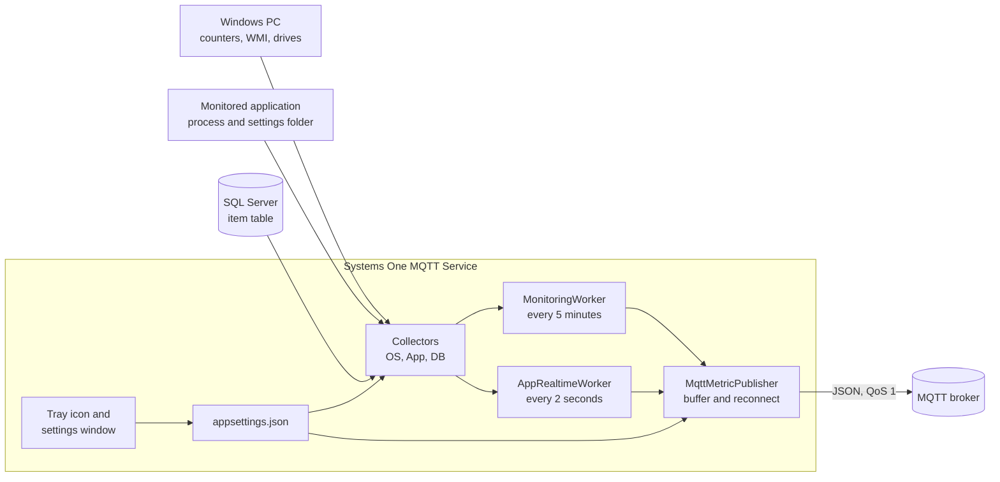

<div align="center">


<h1>Systems One MQTT Service</h1>

A Windows service that watches a manufacturing workstation and reports its health to an MQTT broker.<br>
It reports the state of the PC, of the Systems One application running on it, and of the items logged in its SQL Server database.<br>
Built by Systems One to give one central view of many workstations.

</div>

<p align="center">
  <picture>
    <source media="(prefers-color-scheme: dark)" srcset="docs/assets/systems-one-dark.png">
    
  </picture>
</p>

<p align="center">
  <a href="https://github.com/Systems-One/Systems_One_MQTT_Service/releases/latest"><b>Latest release</b></a> ·
  <a href="#documentation"><b>Documentation</b></a> ·
  <a href="Collectors/Database/README.md">Database collection rules</a> ·
  <a href="MQTTnet_Connection_Summary.md">MQTT connection notes</a> ·
  <a href="appsettings.json">Settings file</a>
</p>

## Contents

- [What it does](#what-it-does)
- [What the system can do](#what-the-system-can-do)
- [How it fits together](#how-it-fits-together)
- [Status](#status)
- [Get started](#get-started)
- [Install or deploy](#install-or-deploy)
- [Documentation](#documentation)
- [Repository layout](#repository-layout)
- [Reference](#reference)

## What it does

The service runs in the background on a workstation. Every five minutes it measures the PC and the database, and every two seconds it checks the monitored application. Each reading is sent as a JSON message to an MQTT broker, so one broker can show the state of many machines.

- Tells you whether a machine is online. The broker reports `offline` by itself if the service or the PC dies.
- Reports CPU, memory, disk space, temperature, uptime and Windows version.
- Reports when the monitored application starts or stops, and when one of its settings files changes.
- Counts the items logged in the last complete five-minute window: total, no-reads, data sent and other counts that depend on the customer's table layout.
- Keeps readings in memory while the broker is unreachable and sends them when the connection returns.

## What the system can do

### Service

Built and released. Unit tests cover the collectors and the topic builder; the test count is in [Status](#status). Nothing in this repository tests the service against a real broker or a real SQL Server.

| Area | Capability |
|------|------------|
| PC health | Windows version, uptime, CPU usage, memory (total, free, used, percent), fixed drives (size, free, used, percent, format) and system temperature with a Normal, Warm, Hot or Critical status |
| Drive selection | Reports the drives listed under `Drives:Monitors` in the settings file, or every ready fixed drive when the list is empty |
| Application watcher | Checks every 2 seconds whether the configured executable is running, and publishes only when the state changes |
| Application settings | Watches the `*.json` files in the configured settings folder and publishes a file's content when its SHA-256 hash changes |
| Database connection | Reports every cycle whether SQL Server can be reached, with the server, database, schema and table as tags |
| Item summary | Counts rows in the window from 10 minutes ago to 5 minutes ago, in local PC time |
| Customer table layouts | Five layouts selected by `Database:SchemaType`: `Default` (`ItemLog`), `Snowsoft` (`tbl_Scanned_Items`), `Madibana` (`tbl_Measurement`), `Twinsaver` (`tbl_Line_Data`) and `FreightSnap` (`FreightScans`) |
| Scheduling | The main cycle runs on clock boundaries (for example :00, :05, :10). The interval is set by `Monitoring:IntervalMinutes` |
| Logging | Console output plus a JSON log file per day in `logs/` next to the executable, 30 files kept |

### Publishing

Built and released. The topic builder has unit tests. The publisher itself (connection, retry, buffer) has no automated tests.

| Area | Capability |
|------|------------|
| Transports | MQTT over TCP (`mqtt://`, `mqtts://`) and over WebSocket (`ws://`, `wss://`), with an optional base path for WebSocket |
| Security | Username and password, TLS, and a switch to skip certificate validation |
| Topic layout | `{BaseTopic}/{Company}/{Location}/{MachineId}/{Source}/{metric}` when company, location and machine ID are all set. Otherwise `{BaseTopic}/{computer name}/{Source}/{metric}` |
| Online status | Publishes a retained `online` on connect and `offline` on a clean stop. A last-will message makes the broker publish `offline` if the connection is lost |
| Delivery | Metrics are published with QoS 1 (at least once) |
| Reconnect | Up to 5 connection attempts at start-up and 3 on reconnect, with increasing delays. A lost connection triggers a reconnect after 5 seconds |
| Buffering | Up to 1000 metrics are held in memory while the broker is unreachable. The oldest are dropped first |
| Identity | The client ID is built from company, location, machine ID and serial number, or the computer name when none are set. The serial number is included in every payload |

### Desktop and delivery

Built and released. No automated tests.

| Area | Capability |
|------|------------|
| Tray application | When the executable is started by a user instead of as a service, it shows a tray icon with Settings and Exit |
| Settings window | Tabs for MQTT, Database and App Watcher. Saves to `appsettings.json` next to the executable |
| Installer | An Inno Setup installer asks for the application to watch, the database, the table layout, the broker and the topic names, then installs and starts the Windows service |
| Upgrade | The installer detects an existing installation, loads its settings into the wizard, and replaces the service |
| Recovery | The installer sets the service to restart after a failure, after 5, 10 and 30 seconds |
| Release pipeline | Every push to `master` runs the tests, builds the installer and publishes a GitHub release |

### Shelved collectors

Written but not proven. The code is in the repository, is not registered in `Program.cs`, and has no tests.

| Area | Capability |
|------|------------|
| PLC errors | Subscribes to a PLC's MQTT broker and summarises PLC and photo-eye alignment errors |
| Cognex readers | Connects to a Cognex reader over TCP using DMCC and publishes a daily report |

## How it fits together



| Part | What it does | Folder |
|------|--------------|--------|
| Start-up | Loads `appsettings.json`, registers collectors, publisher and workers, and chooses between service mode and tray mode | [Program.cs](Program.cs) |
| Workers | `MonitoringWorker` runs every collector on the main interval. `AppRealtimeWorker` runs only the `App` collectors every 2 seconds | [Hosting/](Hosting) |
| OS collectors | Version, uptime, CPU, memory, drives and temperature | [Collectors/OS/](Collectors/OS) |
| App collector | Process state and settings-file changes | [Collectors/App/](Collectors/App) |
| Database collector | Connection status and the item summary, with one query class per table layout | [Collectors/Database/](Collectors/Database) |
| Publisher | Connects to the broker, builds topics, serialises metrics, buffers and reconnects | [Publishing/Mqtt/](Publishing/Mqtt) |
| Contracts | `IMetricCollector`, `IMetricPublisher`, `IScheduler`, `IClock` and the `Metric` type | [Abstractions/](Abstractions), [Metrics/](Metrics) |
| Infrastructure | Clock-aligned scheduler, system clock, and health checks for the broker and the database | [Infrastructure/](Infrastructure) |
| Logging | Serilog set-up for console and daily JSON files | [Logging/](Logging) |
| Desktop UI | Tray icon and settings window | [UI/](UI) |
| Installer | Inno Setup script used by the release pipeline | [setup.iss](setup.iss) |
| Pipeline | Test, build, package and release | [.github/workflows/](.github/workflows) |

### Topics published by the current code

The prefix is `{BaseTopic}/{Company}/{Location}/{MachineId}`, or `{BaseTopic}/{computer name}` when the three names are not all set. Only the first part of a metric ID after the source is used in the topic.

| Topic | Metric ID | When |
|-------|-----------|------|
| `{prefix}/status` | none, plain `online` or `offline` | On connect, on clean stop, and by the broker when the connection is lost |
| `{prefix}/OS/version` | `os.version` | Every cycle |
| `{prefix}/OS/uptime` | `os.uptime` | Every cycle |
| `{prefix}/OS/cpu` | `cpu.usage` | Every cycle |
| `{prefix}/OS/memory` | `memory` | Every cycle |
| `{prefix}/OS/drives` | `os.drives` | Every cycle |
| `{prefix}/OS/temperature` | `temperature` | Every cycle. The status is `unavailable` when no sensor can be read |
| `{prefix}/App/running` | `app.running` | When the application starts or stops |
| `{prefix}/App/settings` | `app.settings.{file name}` | When a settings file changes. All files share this topic |
| `{prefix}/DB/connection` | `db.connection` | Every cycle, when a database server is configured |
| `{prefix}/DB/itemlog` | `db.itemlog.summary` | Every cycle, when the query succeeds |
| `{prefix}/DB/query` | `db.query.error` | When the connection or the query fails |

Each metric payload is a JSON object with `serial_number`, `Id`, `Name`, `Value`, `Unit`, `Timestamp` (local time with offset), `TimestampUnix`, `Source` and `Tags`.

## Status

The latest release is `v2026.08.14.39`, published on 14 August 2026 from the current head of `master`. Its installer, `Systems_One_MQTT_Service_Setup.exe`, is 59.9 MB.

The test project holds 12 test classes with 67 `[Fact]` tests and 5 `[Theory]` tests that carry 26 data rows, which makes 93 test cases. This is a count from the source, not from a test run.

| Part | State |
|------|-------|
| OS collectors | In use. Unit tests for version, uptime, CPU, memory and drives. No test for the temperature collector |
| App collector | In use. 6 unit tests |
| Database collector | In use. Tests cover table selection, table-name validation, the unconfigured case and an unreachable server. The SQL queries are not run against a database in any test |
| Table layouts | `Default`, `Snowsoft`, `Madibana`, `Twinsaver` and `FreightSnap` are in the service. The installer and the settings window offer only the first four, so `FreightSnap` has to be set by editing `Database:SchemaType` in `appsettings.json` |
| MQTT publisher | In use. Topic building has 12 unit tests. Connection, retry and buffering have none |
| Scheduler | In use, 4 unit tests. Cron expressions are not implemented and fall back to a one-minute interval |
| Health checks | Registered for the broker and the database. Nothing in the repository calls them or exposes them |
| Tray icon and settings window | In use. No automated tests |
| Installer | Built by the pipeline for every release. No automated tests. On upgrade the wizard reads the first `Username` and `Password` it finds in the existing settings file, which are the database ones, so check the MQTT user name and password before continuing |
| Settings files | The service reads only `appsettings.json` next to the executable. `appsettings.Development.json` and `appsettings.Production.json.example` are in the repository but are not loaded by the current start-up code |
| PLC error collector | Shelved. Code present, not registered, no tests |
| Cognex DMCC collector | Shelved. Code present, not registered, no tests |
| Visual Studio installer project | `Systems_One_MQTT_Service_Installer/` is not part of the solution and is not used by the pipeline, which builds `setup.iss` |
| License | `LICENSE.txt` is the MIT text with the year and name placeholders not filled in |

## Get started

You need:

- Windows. The projects target `net8.0-windows` and use Windows Forms.
- The .NET 8 SDK. The pipeline builds with `8.0.x`.
- For a full run, an MQTT broker and, for the database metrics, a SQL Server with one of the supported tables.

```bash
# Build the service and the tests
dotnet build Systems_One_MQTT_Service.sln

# Run the unit tests
dotnet test Tests/Systems_One_MQTT_Service.Tests.csproj

# Run the service with its tray icon
dotnet run --project Systems_One_MQTT_Service.csproj
```

> [!WARNING]
> Running the service connects to the broker and the SQL Server named in `appsettings.json` and starts publishing at once. The file in this repository sets `Mqtt:BrokerUrl` to `ws://mqtt.sysone.co.za`. Change it to a test broker before you run the service on a development PC. The database collector stays off while `Database:Server` is empty.

The pipeline builds with `--configuration Release --warnaserror`, so a warning on your machine is a failure there.

## Install or deploy

1. Open the [latest release](https://github.com/Systems-One/Systems_One_MQTT_Service/releases/latest) and download `Systems_One_MQTT_Service_Setup.exe`.
2. Run it as Administrator. The installer requires administrator rights.
3. Choose the install folder. The default is `Systems One MQTT Service` under Program Files.
4. Select the application executable to watch, then the folder where that application keeps its settings.
5. Enter the SQL Server address, database name, user name and password.
6. Choose the database table layout: Default, Snowsoft, Madibana or Twinsaver.
7. Enter the broker URL (`ws://`, `wss://`, `mqtt://` or `mqtts://`), an optional port and base path, and the broker user name and password.
8. Enter the company, location, machine ID, base topic and serial number. These form the topic, for example `systems-one/PEPKOR/WRH/DIM2`.
9. Finish the wizard. The installer writes `appsettings.json` in the install folder, registers the Windows service `Systems One MQTT Service` to start automatically under the LocalSystem account, sets it to restart after a failure, and starts it.

To upgrade, run a newer installer. It stops and removes the old service, loads the existing settings into the wizard for review, and starts the new version.

To change settings later, start `Systems_One_MQTT_Service.exe` from the Start menu shortcut, open Settings from the tray icon, and save. The service reads its settings when it starts, so restart the Windows service afterwards.

> [!WARNING]
> Starting the executable by hand while the Windows service is running gives two copies that publish with the same client ID. Use the tray application to edit settings, then exit it.

## Documentation

| I want to | Read |
|-----------|------|
| See exactly how each database count is calculated for each customer table | [Collectors/Database/README.md](Collectors/Database/README.md) |
| Understand how the service connects to a broker with MQTTnet 4.3 | [MQTTnet_Connection_Summary.md](MQTTnet_Connection_Summary.md) |
| See the settings the service reads and their shipped values | [appsettings.json](appsettings.json) |
| See what the installer asks and what it writes | [setup.iss](setup.iss) |
| See how a release is tested, built and published | [.github/workflows/build-and-release.yml](.github/workflows/build-and-release.yml) |
| Add a new collector | [Abstractions/IMetricCollector.cs](Abstractions/IMetricCollector.cs) and the Extending block in [Reference](#reference) |
| Read the older topic, payload and configuration reference | [Reference](#reference) |
| Check the license | [LICENSE.txt](LICENSE.txt) |

## Repository layout

| Folder or file | What is in it |
|----------------|---------------|
| [.github/workflows/](.github/workflows) | The build, test and release pipeline |
| [Abstractions/](Abstractions) | Interfaces for collectors, publishers, the scheduler and the clock |
| [Collectors/](Collectors) | The collectors: `OS`, `App`, `Database`, and the shelved `PLC` and `Cognex` |
| [Configuration/](Configuration) | Empty placeholder folder |
| [Hosting/](Hosting) | The two background workers |
| [Icons/](Icons) | The application and installer icon |
| [Infrastructure/](Infrastructure) | Scheduler, system clock and health checks |
| [Logging/](Logging) | Serilog set-up |
| [Metrics/](Metrics) | The `Metric` type |
| [Properties/](Properties) | Launch settings for development |
| [Publishing/](Publishing) | The MQTT publisher, its settings and the topic builder |
| [Systems_One_MQTT_Service_Installer/](Systems_One_MQTT_Service_Installer) | An older Visual Studio installer project, not used by the pipeline |
| [Tests/](Tests) | The xUnit test project, with fakes for the clock, scheduler and publisher |
| [UI/](UI) | Tray icon and settings window |
| [docs/assets/](docs/assets) | Images used by this README |
| [Program.cs](Program.cs) | Start-up and registration |
| [setup.iss](setup.iss) | Inno Setup installer script |
| [Systems_One_MQTT_Service.sln](Systems_One_MQTT_Service.sln) | Solution with the service and test projects |

## Reference

The blocks below hold the text of the previous README, unchanged. It was written for an earlier version of the service. Where it differs from the sections above, for example in topic names, payload fields, settings keys and the test count, the sections above describe the current code.

<details>
<summary><b>Introduction</b></summary>

A .NET 8 Worker Service that monitors system health, application state, and database throughput on manufacturing workstations — publishing everything to an MQTT broker for centralized visibility.

```mermaid
flowchart TB
    subgraph Service["Systems One MQTT Service (.NET 8 Worker)"]
        direction TB

        subgraph Workers["Background Workers"]
            MW["<b>MonitoringWorker</b><br/>Every 5 minutes<br/><i>Runs all collectors</i>"]
            ARW["<b>AppRealtimeWorker</b><br/>Every 2 seconds<br/><i>App collectors only</i>"]
        end

        subgraph Interfaces["Core Interfaces"]
            IMC["<b>IMetricCollector</b><br/>Name · Category · CollectAsync()"]
            IMP["<b>IMetricPublisher</b><br/>Connect · Publish · Disconnect"]
            ISched["<b>IScheduler</b><br/>Clock-aligned intervals"]
            IClock["<b>IClock</b><br/>Testable time source"]
        end

        subgraph OS_Cat["OS Collectors"]
            OSV["OsVersionCollector<br/><code>os.version</code>"]
            OSU["OsUptimeCollector<br/><code>os.uptime</code>"]
            CPU["CpuUsageCollector<br/><code>cpu.usage</code>"]
            MEM["MemoryUsageCollector<br/><code>memory.*</code>"]
            DSK["DiskFreeCollector<br/><code>os.drives</code>"]
            TMP["TemperatureCollector<br/><code>system.temperature.*</code>"]
        end

        subgraph App_Cat["App Collectors"]
            APP["AppCollector<br/><code>app.running</code><br/><code>app.settings.*</code>"]
        end

        subgraph DB_Cat["DB Collectors"]
            DBC["DatabaseCollector<br/><code>db.connection</code><br/><code>db.itemlog.summary</code>"]
        end

        subgraph Pub["MQTT Publisher"]
            MQTT["<b>MqttMetricPublisher</b><br/>Auto-reconnect · QoS 1<br/>Metric buffer (1000 max)<br/>LWT offline detection"]
        end

        subgraph Infra["Infrastructure"]
            SC["SystemClock"]
            IS["IntervalScheduler<br/><i>Clock-boundary aligned</i>"]
            MHC["MqttHealthCheck"]
            DHC["DatabaseHealthCheck"]
            SL["SerilogStartup<br/><i>Console + JSON file</i>"]
        end
    end

    subgraph External["External Systems"]
        BROKER[("MQTT Broker<br/><i>Mosquitto etc.</i>")]
        SQLDB[("SQL Server<br/><i>Systems_One DB</i>")]
        SYSONE["Sys_One_Static_App.exe<br/><i>Monitored application</i>"]
        SETTINGS["Settings JSON Files<br/><i>App configuration</i>"]
        WMI["WMI / sysfs<br/><i>Thermal sensors</i>"]
        PERFCTR["Performance Counters<br/><i>CPU · Memory</i>"]
    end

    subgraph Consumers["Downstream Consumers"]
        DASH["Monitoring Dashboard<br/><i>Grafana · Node-RED</i>"]
        ALERT["Alert System<br/><i>Threshold triggers</i>"]
    end

    %% Worker → Interface connections
    MW --> IMC
    MW --> IMP
    MW --> ISched
    ARW --> IMC
    ARW --> IMP

    %% Interface → Implementation
    IMC -.-> OSV & OSU & CPU & MEM & DSK & TMP & APP & DBC
    IMP -.-> MQTT
    ISched -.-> IS
    IClock -.-> SC

    %% Collector → External data sources
    DBC --> SQLDB
    APP --> SYSONE
    APP --> SETTINGS
    TMP --> WMI
    CPU --> PERFCTR
    MEM --> PERFCTR
    DSK -->|"DriveInfo API"| OS_Cat

    %% Publisher → Broker → Consumers
    MQTT --> BROKER
    BROKER --> DASH
    BROKER --> ALERT

    %% Health checks
    MHC -.-> MQTT
    DHC -.-> SQLDB

    %% Styling
    style Service fill:#1a1a2e,stroke:#16213e,color:#eee
    style Workers fill:#0f3460,stroke:#533483,color:#eee
    style Interfaces fill:#16213e,stroke:#533483,color:#eee
    style OS_Cat fill:#1a3a1a,stroke:#2d6a2d,color:#eee
    style App_Cat fill:#3a3a1a,stroke:#6a6a2d,color:#eee
    style DB_Cat fill:#1a1a3a,stroke:#2d2d6a,color:#eee
    style Pub fill:#3a1a1a,stroke:#6a2d2d,color:#eee
    style Infra fill:#2a2a2a,stroke:#4a4a4a,color:#eee
    style External fill:#0d1117,stroke:#30363d,color:#c9d1d9
    style Consumers fill:#0d1117,stroke:#30363d,color:#c9d1d9
```

</details>

<details>
<summary><b>System Overview</b></summary>



### How It Works

1. **MonitoringWorker** wakes every 5 minutes (clock-boundary aligned), runs all collectors sequentially, and publishes each batch to MQTT.
2. **AppRealtimeWorker** runs every 2 seconds, but only calls collectors in the `App` category — detecting process start/stop and config file changes in near real-time.
3. The **MqttMetricPublisher** maintains a persistent connection to the broker. If the connection drops, it auto-reconnects with exponential backoff and buffers up to 1000 metrics in memory until delivery resumes.
4. A **Last Will and Testament** message ensures the broker publishes `"offline"` if the service dies unexpectedly.

</details>

<details>
<summary><b>MQTT Topics &amp; Payloads</b></summary>

All topics follow the pattern:

```
{BaseTopic}/{MachineName}/{Source}/{MetricPath}
```

Metric ID dots become slashes, and the source prefix is stripped to avoid duplication.
Example: metric `os.version` with Source `OS` → `systems-one/WORKSTATION01/OS/version`

Assuming `BaseTopic = "systems-one"` and `MachineName = "WORKSTATION01"`:

---

### Service Status

#### `systems-one/WORKSTATION01/status`

Published with `retain=true` on connect/disconnect. LWT guarantees `"offline"` on crash.

```json
"online"
```

---

### OS Metrics

#### `systems-one/WORKSTATION01/OS/version`

```json
{
  "Id": "os.version",
  "Name": "Operating System Version",
  "Value": "Microsoft Windows NT 10.0.22631.0",
  "Unit": null,
  "Timestamp": 1711350000,
  "Source": "OS",
  "Tags": {
    "platform": "Win32NT",
    "version_major": 10,
    "version_minor": 0,
    "version_build": 22631
  }
}
```

#### `systems-one/WORKSTATION01/OS/uptime`

```json
{
  "Id": "os.uptime",
  "Name": "Operating System Uptime",
  "Value": 432015.7,
  "Unit": "seconds",
  "Timestamp": 1711350000,
  "Source": "OS",
  "Tags": {
    "uptime_days": 5,
    "uptime_hours": 0,
    "uptime_minutes": 0
  }
}
```

#### `systems-one/WORKSTATION01/OS/cpu/usage`

```json
{
  "Id": "cpu.usage",
  "Name": "CPU Usage",
  "Value": 23.45,
  "Unit": "percent",
  "Timestamp": 1711350000,
  "Source": "OS",
  "Tags": {
    "processor_count": 8
  }
}
```

#### `systems-one/WORKSTATION01/OS/memory/total`

```json
{
  "Id": "memory.total",
  "Name": "Total Memory",
  "Value": 16384.0,
  "Unit": "MB",
  "Timestamp": 1711350000,
  "Source": "OS",
  "Tags": null
}
```

#### `systems-one/WORKSTATION01/OS/memory/available`

```json
{
  "Id": "memory.available",
  "Name": "Available Memory",
  "Value": 8192.5,
  "Unit": "MB",
  "Timestamp": 1711350000,
  "Source": "OS",
  "Tags": null
}
```

#### `systems-one/WORKSTATION01/OS/memory/used`

```json
{
  "Id": "memory.used",
  "Name": "Used Memory",
  "Value": 8191.5,
  "Unit": "MB",
  "Timestamp": 1711350000,
  "Source": "OS",
  "Tags": null
}
```

#### `systems-one/WORKSTATION01/OS/memory/usage`

```json
{
  "Id": "memory.usage",
  "Name": "Memory Usage",
  "Value": 49.99,
  "Unit": "percent",
  "Timestamp": 1711350000,
  "Source": "OS",
  "Tags": null
}
```

#### `systems-one/WORKSTATION01/OS/drives`

```json
{
  "Id": "os.drives",
  "Name": "Operating System Drives",
  "Value": [
    {
      "drive": "C:",
      "totalGB": 476.34,
      "freeGB": 234.12,
      "usedGB": 242.22,
      "usagePercent": 50.85,
      "driveType": "Fixed",
      "format": "NTFS"
    },
    {
      "drive": "D:",
      "totalGB": 931.51,
      "freeGB": 612.33,
      "usedGB": 319.18,
      "usagePercent": 34.26,
      "driveType": "Fixed",
      "format": "NTFS"
    }
  ],
  "Unit": null,
  "Timestamp": 1711350000,
  "Source": "OS",
  "Tags": {
    "drive_count": 2,
    "filter": "internal_only"
  }
}
```

#### `systems-one/WORKSTATION01/OS/system/temperature/average`

```json
{
  "Id": "system.temperature.average",
  "Name": "Average System Temperature",
  "Value": 52.3,
  "Unit": "°C",
  "Timestamp": 1711350000,
  "Source": "OS",
  "Tags": {
    "sensor_count": 2,
    "max_temp": 58.1,
    "status": "Warm"
  }
}
```

#### `systems-one/WORKSTATION01/OS/system/temperature/sensors`

```json
{
  "Id": "system.temperature.sensors",
  "Name": "Temperature Sensors",
  "Value": [
    { "Name": "ACPI\\ThermalZone\\TZ00_0", "Temperature": 52.3, "Source": "MSAcpi" },
    { "Name": "ACPI\\ThermalZone\\TZ01_0", "Temperature": 58.1, "Source": "MSAcpi" }
  ],
  "Unit": "°C",
  "Timestamp": 1711350000,
  "Source": "OS",
  "Tags": null
}
```

#### `systems-one/WORKSTATION01/OS/system/temperature/status`

Only published when no temperature sensors are detected on the system.

```json
{
  "Id": "system.temperature.status",
  "Name": "Temperature Monitoring",
  "Value": "No sensors detected",
  "Unit": null,
  "Timestamp": 1711350000,
  "Source": "OS",
  "Tags": null
}
```

---

### Application Metrics

#### `systems-one/WORKSTATION01/App/running`

Published only on state change (running → stopped or stopped → running).

```json
{
  "Id": "app.running",
  "Name": "App Running",
  "Value": true,
  "Unit": null,
  "Timestamp": 1711350000,
  "Source": "App",
  "Tags": {
    "process_name": "Sys_One_Static_App",
    "exe_path": "C:\\Program Files\\SystemsOne\\StaticInstaller\\Sys_One_Static_App.exe",
    "process_count": 1,
    "path_match": true
  }
}
```

#### `systems-one/WORKSTATION01/App/settings/{filename}`

Published when a JSON file in the settings directory changes (detected via SHA256 hash).

```json
{
  "Id": "app.settings.AppConfig",
  "Name": "AppConfig settings",
  "Value": {
    "ScanMode": "continuous",
    "BarcodeType": "2D",
    "Timeout": 5000
  },
  "Unit": null,
  "Timestamp": 1711350000,
  "Source": "App",
  "Tags": {
    "path": "C:\\Users\\Public\\Documents\\SystemOne_App_Settings\\AppConfig.json",
    "hash": "A1B2C3D4E5F67890ABCDEF1234567890ABCDEF1234567890ABCDEF1234567890"
  }
}
```

---

### Database Metrics

#### `systems-one/WORKSTATION01/DB/connection`

```json
{
  "Id": "db.connection",
  "Name": "Database Connection Status",
  "Value": true,
  "Unit": null,
  "Timestamp": 1711350000,
  "Source": "DB",
  "Tags": {
    "server": "192.168.1.16,1433",
    "database": "Systems_One",
    "table": "ItemLog"
  }
}
```

#### `systems-one/WORKSTATION01/DB/itemlog/summary`

5-minute window aggregation of the ItemLog table.

```json
{
  "Id": "db.itemlog.summary",
  "Name": "ItemLog Summary (5-minute window)",
  "Value": {
    "Total_Items": 142,
    "No_Read": 3,
    "Good_Read": 139,
    "No_Dimension": 1,
    "No_Weight": 0,
    "Data_Sent": 140,
    "Not_Sent": 2,
    "Image_Sent": 138,
    "Image_Not_Sent": 4,
    "Item_Out_Of_Spec": 5,
    "More_Than_1_Item": 2
  },
  "Unit": null,
  "Timestamp": 1711350000,
  "Source": "DB",
  "Tags": {
    "startUtc": "2026-03-25T14:45:00Z",
    "endUtc": "2026-03-25T14:50:00Z"
  }
}
```

#### `systems-one/WORKSTATION01/DB/query/error`

Published when the database query fails.

```json
{
  "Id": "db.query.error",
  "Name": "Database Query Error",
  "Value": "A network-related or instance-specific error occurred while establishing a connection to SQL Server.",
  "Unit": null,
  "Timestamp": 1711350000,
  "Source": "DB",
  "Tags": null
}
```

---

### Topic Quick Reference

| Topic | Metric ID | Interval | When Published |
|-------|-----------|----------|----------------|
| `…/status` | — | On connect/disconnect | Always (retained) |
| `…/OS/version` | `os.version` | 5 min | Every cycle |
| `…/OS/uptime` | `os.uptime` | 5 min | Every cycle |
| `…/OS/cpu/usage` | `cpu.usage` | 5 min | Every cycle |
| `…/OS/memory/total` | `memory.total` | 5 min | Every cycle |
| `…/OS/memory/available` | `memory.available` | 5 min | Every cycle |
| `…/OS/memory/used` | `memory.used` | 5 min | Every cycle |
| `…/OS/memory/usage` | `memory.usage` | 5 min | Every cycle |
| `…/OS/drives` | `os.drives` | 5 min | Every cycle |
| `…/OS/system/temperature/average` | `system.temperature.average` | 5 min | When sensors detected |
| `…/OS/system/temperature/sensors` | `system.temperature.sensors` | 5 min | When sensors detected |
| `…/OS/system/temperature/status` | `system.temperature.status` | 5 min | Only when no sensors |
| `…/App/running` | `app.running` | 2 sec | On state change only |
| `…/App/settings/{name}` | `app.settings.{name}` | 2 sec | On file change only |
| `…/DB/connection` | `db.connection` | 5 min | Every cycle |
| `…/DB/itemlog/summary` | `db.itemlog.summary` | 5 min | Every cycle |
| `…/DB/query/error` | `db.query.error` | 5 min | On query failure |

</details>

<details>
<summary><b>Configuration</b></summary>

### Full `appsettings.json` with all valid settings

```json
{
  "Serilog": {
    "MinimumLevel": {
      "Default": "Information",
      "Override": {
        "Microsoft": "Warning",
        "System": "Warning",
        "MQTTnet": "Warning"
      }
    },
    "Enrich": [
      "FromLogContext",
      "WithMachineName",
      "WithThreadId",
      "WithProcessId"
    ],
    "WriteTo": [
      {
        "Name": "Console",
        "Args": {
          "outputTemplate": "[{Timestamp:HH:mm:ss} {Level:u3}] {Message:lj} <{SourceContext}>{NewLine}{Exception}"
        }
      },
      {
        "Name": "File",
        "Args": {
          "path": "logs/system-one-.json",
          "formatter": "Serilog.Formatting.Json.JsonFormatter, Serilog",
          "rollingInterval": "Day",
          "retainedFileCountLimit": 30
        }
      }
    ]
  },

  "AppCollector": {
    "ExePath": "C:\\Program Files\\SystemsOne\\StaticInstaller\\Sys_One_Static_App.exe",
    "SettingsDir": "C:\\Users\\Public\\Documents\\SystemOne_App_Settings"
  },

  "Database": {
    "Server": "192.168.1.16,1433",
    "DatabaseName": "Systems_One",
    "TableName": "ItemLog",
    "TimeoutSeconds": 30
  },

  "Drives": {
    "Monitors": [
      { "Path": "C:" },
      { "Path": "D:" }
    ]
  },

  "Monitoring": {
    "IntervalMinutes": 5
  },

  "Mqtt": {
    "BrokerUrl": "mqtt://192.168.1.16",
    "BrokerPort": 1883,
    "ClientId": "systems-one-service",
    "BaseTopic": "systems-one"
  }
}
```

### `appsettings.Production.json` (credentials — never commit)

```json
{
  "Database": {
    "Username": "sa",
    "Password": "YourDatabasePassword"
  },
  "Mqtt": {
    "Username": "mqtt-user",
    "Password": "YourMqttPassword"
  }
}
```

### Configuration Reference

| Section | Key | Type | Default | Description |
|---------|-----|------|---------|-------------|
| `AppCollector` | `ExePath` | string | `Sys_One_Static_App.exe` path | Full path to the monitored executable |
| `AppCollector` | `SettingsDir` | string | `SystemOne_App_Settings` path | Directory containing JSON settings files to watch |
| `Database` | `Server` | string | — | SQL Server host and port (e.g. `192.168.1.16,1433`) |
| `Database` | `DatabaseName` | string | — | Database name |
| `Database` | `TableName` | string | `ItemLog` | Table to query for item summaries |
| `Database` | `TimeoutSeconds` | int | `30` | SQL connection timeout |
| `Database` | `Username` | string | — | SQL auth username *(Production.json)* |
| `Database` | `Password` | string | — | SQL auth password *(Production.json)* |
| `Drives` | `Monitors` | array | `[]` | List of `{ "Path": "C:" }` entries. Empty = all fixed drives |
| `Monitoring` | `IntervalMinutes` | int | `5` | Main collection loop interval |
| `Mqtt` | `BrokerUrl` | string | — | MQTT broker URL (e.g. `mqtt://192.168.1.16`) |
| `Mqtt` | `BrokerPort` | int | `1883` | MQTT broker port |
| `Mqtt` | `ClientId` | string | Machine name | MQTT client identifier |
| `Mqtt` | `BaseTopic` | string | `systems-one` | Root topic prefix for all published metrics |
| `Mqtt` | `Username` | string | — | MQTT auth username *(Production.json)* |
| `Mqtt` | `Password` | string | — | MQTT auth password *(Production.json)* |

</details>

<details>
<summary><b>Build &amp; Run</b></summary>

### Prerequisites

- .NET 8 SDK
- SQL Server (for database metrics)
- MQTT broker (e.g. Mosquitto)

### Commands

```bash
# Build
dotnet build

# Run
dotnet run

# Run tests
dotnet test Tests/Systems_One_MQTT_Service.Tests.csproj

# Publish for deployment
dotnet publish -c Release --runtime win-x64 --self-contained true --output ./publish
```

</details>

<details>
<summary><b>Testing</b></summary>

46 unit tests across 11 test classes. Tests must pass before the CI pipeline builds the installer.

```bash
dotnet test Tests/Systems_One_MQTT_Service.Tests.csproj --verbosity normal
```

CI pipeline:

```
Push to master → [Run Tests] → Pass? → [Build + Package Installer] → GitHub Release
                                  ↓ Fail
                              Build blocked
```

</details>

<details>
<summary><b>Deployment</b></summary>

### Installer (recommended)

The CI pipeline produces `Systems_One_MQTT_Service_Setup.exe` which:

1. Prompts for Database and MQTT credentials
2. Writes `appsettings.Production.json`
3. Handles upgrades (stops/removes existing service)
4. Installs as a Windows Service with auto-start
5. Configures restart-on-failure (5s → 10s → 30s)

### Manual

```powershell
dotnet publish -c Release --runtime win-x64 --self-contained true --output C:\Services\SystemsOneMqtt

sc create "Systems One MQTT Service" binPath="C:\Services\SystemsOneMqtt\Systems_One_MQTT_Service.exe" start=auto
sc failure "Systems One MQTT Service" reset=86400 actions=restart/5000/restart/10000/restart/30000
sc start "Systems One MQTT Service"
```

</details>

<details>
<summary><b>Extending</b></summary>

Implement `IMetricCollector`, register in `Program.cs`, done:

```csharp
public class MyCollector : IMetricCollector
{
    public string Name => "My Collector";
    public string Category => "Custom";
    private readonly IClock _clock;

    public MyCollector(IClock clock) => _clock = clock;

    public Task<IEnumerable<Metric>> CollectAsync(CancellationToken ct = default)
    {
        return Task.FromResult<IEnumerable<Metric>>(new[]
        {
            new Metric { Id = "custom.value", Name = "Custom", Value = 42, Source = "Custom", Timestamp = _clock.UtcNow }
        });
    }
}
```

</details>

<details>
<summary><b>Roadmap</b></summary>

### Shelved (code present, dormant)

| Feature | Description | Enable by |
|---------|-------------|-----------|
| **PLC Error Collector** | Subscribes to PLC MQTT broker, surfaces PE alignment errors | Uncomment in `Program.cs`, add `PlcErrorCollector` config |
| **Cognex DMCC Collector** | Daily barcode reader performance reports via TCP/DMCC | Uncomment in `Program.cs`, add `CognexDmcc` config |

### Planned

| Feature | Priority | Notes |
|---------|----------|-------|
| Legacy DB schema auto-detection | Medium | v1/v2/v3 query templates based on INFORMATION_SCHEMA |
| Parallel collector execution | Medium | `Task.WhenAll` to reduce cycle time |
| Integration tests (TestContainers) | Low | Real MQTT + SQL in Docker |
| Prometheus / OpenTelemetry export | Low | Alternative publisher |

</details>

<details>
<summary><b>License</b></summary>

See [LICENSE.txt](LICENSE.txt).

</details>
